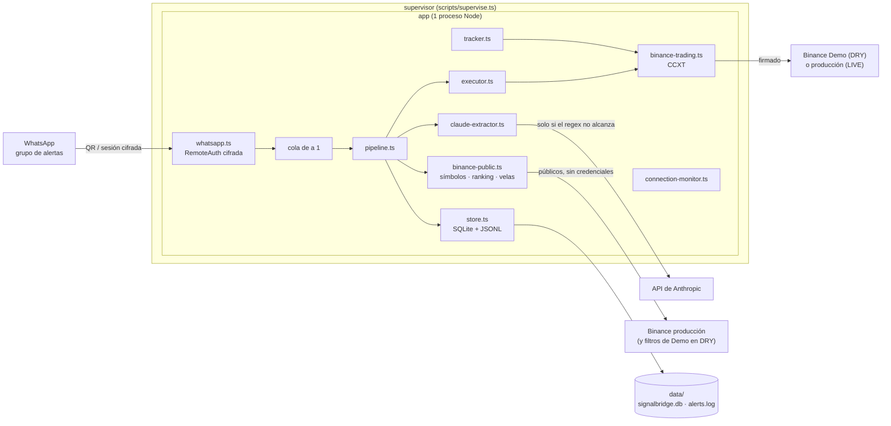
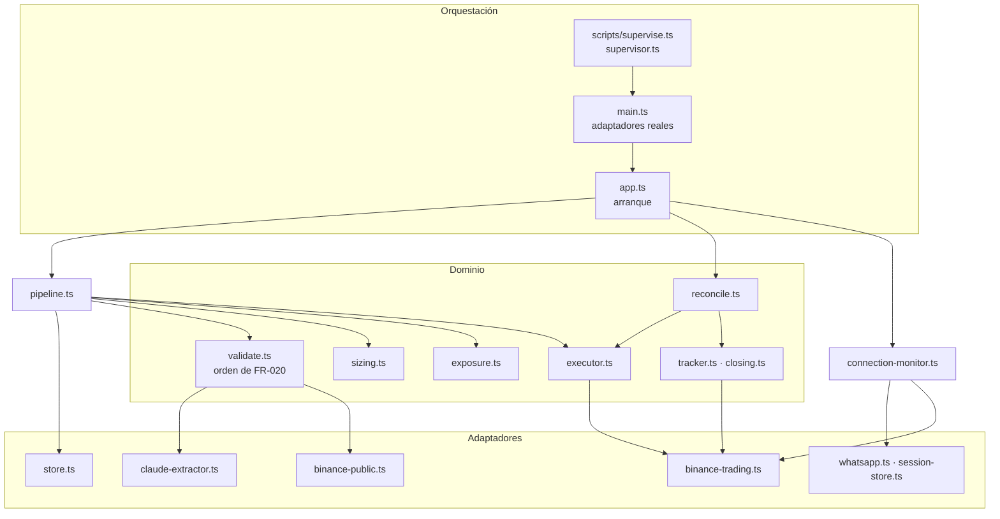
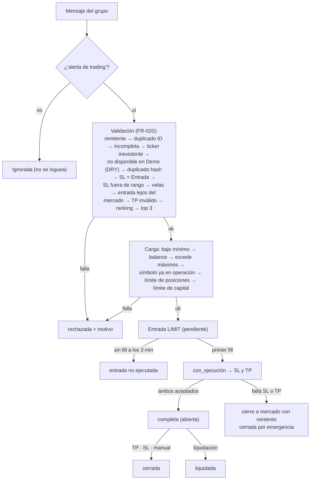

# Arquitectura de SignalBridge

Estado: los tres tramos del PRD están implementados con tests: ingesta y validación
([PRD-001](prd/PRD-001-ingesta-validacion.md)), carga protegida de la operación
([PRD-002](prd/PRD-002-carga-reversion.md)) y seguimiento hasta el cierre
([PRD-003](prd/PRD-003-seguimiento-cierre.md)), con reconciliación al arrancar, monitor de conexión,
reinicio automático y sesión de WhatsApp cifrada. La validación en vivo de punta a punta en DRY y la
revisión de la key de producción están en
[checklists/live.md](../specs/001-alertas-whatsapp-binance/checklists/live.md).

## 1. Contexto

Un supervisor corre un único proceso Node que lee el grupo de WhatsApp, valida cada alerta y, si es
válida, la carga en Binance Futuros con su SL y su TP. En DRY opera contra Binance Demo Trading y en
LIVE contra producción. Todo queda en disco local.



Idea guía: todo lo que habla con el exterior (WhatsApp, Binance, Claude, disco) es un **adaptador**
chico detrás de un puerto ([contracts/ports.md](../specs/001-alertas-whatsapp-binance/contracts/ports.md)),
y las reglas del PRD viven en **funciones de dominio** que no saben de dónde viene el dato. Los tests
cubren cada criterio de aceptación con fakes y un reloj falso, sin red ni cuentas.

## 2. Módulos



| Módulo | Responsabilidad |
|---|---|
| `filter.ts`, `parser.ts`, `extract.ts` | Disparador y remitentes (FR-001, FR-002); regex primero y Claude solo para lo que falta (FR-003 a FR-005, FR-059). Lo que saca el regex manda. |
| `claude-extractor.ts` | Respaldo con Claude y salida estructurada. Opcional: sin `ANTHROPIC_API_KEY` no se analiza la imagen (FR-004). |
| `identity.ts` | `alertId` y hash sobre el símbolo mapeado y los precios ajustados al tick (FR-006). |
| `symbols.ts`, `candles.ts`, `indicators.ts`, `ranking.ts` | Mapeo `TICKERUSDT`/`1000TICKERUSDT`, ajuste al tick, velas de 45 min, ASL21/EMA55 y top 3. |
| `validate.ts` | Validaciones en el orden de FR-020 hasta "top 3"; un único motivo. |
| `sizing.ts`, `exposure.ts` | Cantidad por riesgo R, mínimos y máximos; símbolo ya en operación y límites de posiciones y capital. |
| `executor.ts` | Entrada límite, SL y TP al primer fill, plazo de 3 min y cierre de emergencia sin límite de reintentos (FR-027 a FR-032). |
| `tracker.ts`, `closing.ts` | Polling cada 2 s: cierre con causa, PnL y comisiones; cancela huérfanas; SL/TP perdido (FR-033 a FR-038). |
| `reconcile.ts` | Al arrancar retoma lo que quedó a medias y registra los cierres de la caída (FR-039 a FR-042, FR-065). |
| `connection-monitor.ts` | Cortes de WhatsApp y Binance, backoff 1…60 s y salida al 10.º fallo, salvo cierre de emergencia (FR-055). |
| `supervisor.ts` | Relanza la app ante caídas en < 60 s; no ante 0, 78 ni Ctrl+C (FR-056). |
| `binance-public.ts` | Datos públicos de producción; en DRY, filtros de órdenes de Demo (FR-017, FR-066, FR-067). |
| `binance-trading.ts` | `Exchange` sobre CCXT con endpoints crudos; SL/TP como órdenes condicionales de la API "algo". |
| `whatsapp.ts`, `session-store.ts` | QR, grupo, mensajes en vivo y ediciones; sesión `RemoteAuth` cifrada con AES-256-GCM (FR-049). |
| `store.ts`, `log-record.ts` | SQLite para alertas, ediciones y operaciones; JSONL con el registro de cada estado final. |

## 3. Flujo de una alerta



Solo los estados finales se loguean en `data/alerts.log`; los de trabajo viven en la base
([contracts/log-record.md](../specs/001-alertas-whatsapp-binance/contracts/log-record.md)).

## 4. Secuencia en vivo

```mermaid
sequenceDiagram
  participant WA as WhatsApp
  participant A as app.ts
  participant P as pipeline.ts
  participant X as executor.ts
  participant T as tracker.ts
  participant B as Binance (trading)

  Note over A,B: Arranque: config → datos públicos → reconciliación → recién entonces WhatsApp
  WA->>A: mensaje nuevo (hora de llegada marcada por el adaptador)
  A->>P: processMessage (de a uno por vez)
  P->>P: validación, dimensionamiento y límites
  P->>X: open(alerta, cantidad)
  X->>B: margen aislado + apalancamiento, entrada LIMIT
  loop cada 2 s
    X->>B: ¿fill?
  end
  X->>B: con_ejecución guardado → SL y TP (closePosition)
  X-->>A: completa (log)
  loop cada 2 s
    T->>B: ¿sigue la posición? ¿están el SL y el TP?
  end
  T->>B: cierre: causa, PnL y comisiones; cancela la orden que quedó
```

## 5. Datos

```text
data/                      (0700)
├── signalbridge.db        (0600)  SQLite: alerts, edits, trades (record JSON por fila)
└── alerts.log             (0600)  JSONL: alert · edit · connection · critical
.wwebjs_auth/              (0700)
└── RemoteAuth-signalbridge.session.enc  (0600)  sesión de WhatsApp cifrada
```

- `alertId` = `<ID de WhatsApp>:<hash de 16 hex>`. El hash usa el símbolo mapeado y los precios
  ajustados al tick; solo una alerta no rechazada de las últimas 24 h bloquea un reenvío (FR-007).
- Una operación ocupa cupo y bloquea su símbolo mientras está `pendiente`, `con_ejecución` o
  `abierta` ([data-model.md](../specs/001-alertas-whatsapp-binance/data-model.md)).

## 6. Decisiones

| Decisión | Por qué |
|---|---|
| Regex primero, Claude solo de respaldo | Las alertas reales parsean con regex en ~1 ms; Claude es más lento, cuesta y es opcional. |
| Dominio + puertos + fakes | Las reglas del PRD se prueban sin WhatsApp, Binance ni Claude, con reloj falso. |
| Cola de a un mensaje | Los límites y los duplicados se evalúan siempre contra el estado actual (FR-061). |
| `con_ejecución` guardado antes de pedir SL/TP | Si el proceso cae ahí, la reconciliación sabe que esa posición nunca quedó protegida (FR-065). |
| SL/TP con `closePosition` y precio de marca | Cubren toda la posición, incluidos fills posteriores, sin recalcular cantidades. Binance solo los acepta con la posición abierta (visto en Demo, T063). |
| Cierre de emergencia sin límite de reintentos | Una posición sin SL y TP no puede quedar abierta por decisión del sistema (Principio III). |
| Filtros de órdenes de Demo en DRY | Demo rechaza órdenes armadas con el tick de producción (-4014 en v3); ranking y velas siguen en producción. |
| Causa del cierre por la orden que dejó la posición en cero | Contra el `actualOrderId` del SL/TP y las órdenes de liquidación de Binance (como v3). |
| Solo errores de red cuentan como corte de Binance | Un rechazo de orden es una respuesta; no debe disparar reconexiones ni la salida al 10.º fallo. |
| Sesión `RemoteAuth` cifrada | Con el proceso detenido solo queda el archivo cifrado; el perfil en claro se borra al cerrar y al arrancar. |
| Supervisor propio en vez de systemd | Cumple el reinicio en < 60 s en la máquina del operador sin instalar nada (R-10). |
| Ante la duda, rechazar | Si fallan Claude, las velas, el balance o el ranking es viejo, la alerta se rechaza con motivo. |

## 7. Pendientes

- Validación de punta a punta en DRY según [quickstart.md](../specs/001-alertas-whatsapp-binance/quickstart.md)
  (T085): primer vínculo con `RemoteAuth`, `kill -9` con el supervisor y lotes de latencia.
- Descarga de imágenes de WhatsApp: en v3 `downloadMedia` fallaba con "r"; el respaldo por imagen
  (FR-004) se verifica en vivo en T085.
- Revisar en Binance que la key de producción tenga solo trading (T081), antes de LIVE.
